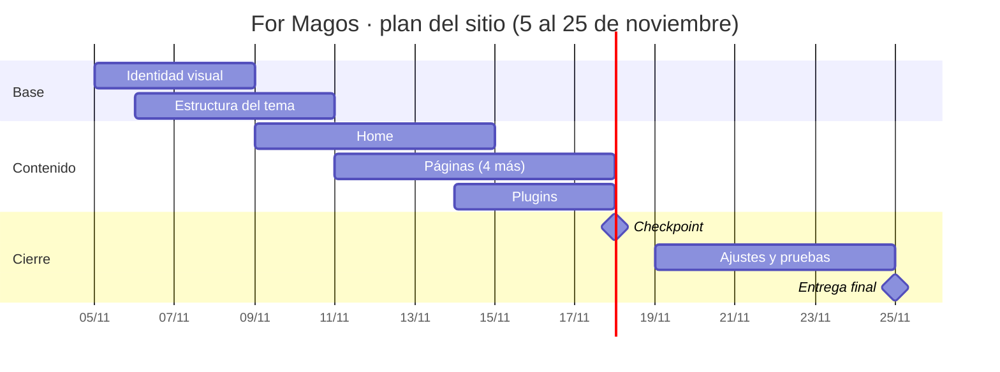

# Decisiones del sitio · For Magos

**Emprendimiento:** For Magos, camisetas de fútbol de las grandes ligas (Premier League, Liga Chilena, Liga Española, Bundesliga, Ligue 1 y Serie A), vestuario deportivo y ropa urbana.

**Idea del sitio:** un sitio oscuro, rápido y con estilo de "drop" de streetwear, donde cada liga y cada colección se explora como un lookbook. La tienda (carro y pago) queda para una fase posterior.

---

## 1. Plugins

Datos revisados en las fichas de wordpress.org el miércoles 4 de noviembre de 2026.

| # | Plugin | Funcionalidad que resuelve | Gratis o de pago (qué incluye lo gratis) | Probado hasta (WP) | ¿Funciona con tema custom? | Ficha oficial |
|---|---|---|---|---|---|---|
| 1 | **Yoast SEO** (obligatorio, SEO) | Títulos y descripciones por página, sitemap XML y datos para que For Magos aparezca en Google al buscar "camisetas de fútbol" | Gratis, con versión Premium de pago. Lo gratis incluye análisis SEO y de legibilidad, sitemap y datos estructurados; Premium agrega herramientas de IA, bloqueo de bots y soporte directo | **7.1.4** (versión 28.8). Requiere WP 7.0 o superior y PHP 7.4 o superior | Sí, mientras el tema llame a `wp_head()` | https://wordpress.org/plugins/wordpress-seo/ |
| 2 | **Contact Form 7** (obligatorio, contacto) | Formulario de contacto y de consulta por talla o camiseta | Gratis. Todas sus funciones son gratuitas; vive de donaciones | **7.1.4** (versión 6.2.4.1). Requiere **WP 7.1 o superior y PHP 8.3 o superior** | Sí. Trae un bloque de WordPress para insertar el formulario en cualquier página | https://wordpress.org/plugins/contact-form-7/ |
| 3 | **BackWPup** | Copia de seguridad de archivos y base de datos antes de cada cambio grande, y restauración | Gratis, con versión Pro de pago. Lo gratis automatiza, guarda y restaura copias; Pro suma recuperación avanzada, migración, seguridad y algunos destinos de almacenamiento | **7.1.4** (versión 5.7.8). Requiere WP 5.3 o superior y PHP 7.4 o superior | Sí, respalda cualquier tema | https://wordpress.org/plugins/backwpup/ |
| 4 | **Akismet Anti-spam** | Filtra el spam que llega por el formulario de contacto y los comentarios | Gratis solo para sitios personales sin fines comerciales; un sitio que vende necesita un plan de pago | **7.1.4** (versión 5.7.2; según un espejo de wordpress.org, la ficha puede mostrar 7.1.x). Requiere WP 5.8 o superior y PHP 7.2 o superior | Sí, no depende del tema | https://wordpress.org/plugins/akismet/ |
| 5 | **Smash Balloon Social Photo Feed** (antes "Instagram Feed") | Muestra el feed de Instagram de For Magos en el home (looks y novedades) | Gratis, con versión Pro de pago. Lo gratis muestra el feed de tu cuenta con opciones de diseño; los extras (hashtags, lightbox, video) son Pro | **7.1.4** (versión 6.15.1). Requiere WP 4.1 o superior y PHP 7.4 o superior | Sí, con el shortcode `[instagram-feed]` o un bloque | https://wordpress.org/plugins/instagram-feed/ |
| 6 | **Smush** | Comprime las fotos de camisetas y activa carga diferida (lazy load) para que el sitio sea rápido | Gratis, con versión Pro de pago. Lo gratis comprime las imágenes y activa lazy load; la compresión del archivo original a tamaño completo es Pro | **7.1.4** (versión 4.3.6). Requiere WP 6.4 o superior y PHP 7.4 o superior | Sí, trabaja sobre la biblioteca de medios | https://wordpress.org/plugins/wp-smushit/ |

**Alternativas anotadas (por si un plugin falla; sus fichas aún no están revisadas):**
- Contact Form 7 → otro plugin de formularios de wordpress.org, o un botón directo a WhatsApp
- Akismet → Antispam Bee (gratis para sitios comerciales)
- Smash Balloon → galería de bloques nativa de WordPress, con fotos subidas a mano
- BackWPup → UpdraftPlus
- Smush → comprimir las fotos a mano antes de subirlas

**Requisitos que afectan al proyecto:** Contact Form 7 pide WP 7.1+ y PHP 8.3+, y Yoast pide WP 7.0+. Mi WordPress en Local WP y en InfinityFree debe cumplir esas versiones. Según el foro de InfinityFree, el hosting gratis usa PHP 8.4 desde fines de septiembre de 2026.

---

## 2. Páginas de la fase 1

| # | Página | Por qué la elegí |
|---|---|---|
| 1 | **Inicio** (obligatoria) | Es la vitrina: presenta las ligas, las novedades y lleva al contacto |
| 2 | **Contacto** (obligatoria) | Los clientes pedirán tallas y camisetas por formulario, WhatsApp e Instagram mientras no exista el carro |
| 3 | **Camisetas de fútbol** | Es el producto principal. Se organiza por liga como catálogo, sin carro ni pago |
| 4 | **Urban & Sport** | Muestra el vestuario deportivo y la ropa urbana como lookbook y marca el estilo moderno del sitio |
| 5 | **Nosotros** | Cuenta qué es For Magos y por qué confiar, algo clave para una tienda nueva |

> Adaptar a las páginas que planteé en el Parcial 02 si los nombres son distintos.

**Páginas para una fase posterior:** Tienda con carro de compras, Pago (checkout), Mi cuenta, Seguimiento de pedido, Guía de tallas, Blog o Noticias, Preguntas frecuentes.

---

## 3. Plan del tema

- **Nombre del tema:** `magos-kickoff`
- **Custom o descargado:** **Custom.** Es un tema de bloques (con `theme.json`) hecho por mí, para controlar el diseño y practicar lo aprendido. Si no avanza a más tardar el miércoles 11 de noviembre, cambio a un tema descargado (ver plan B).
- **Estilo:** modo oscuro con un color de acento llamativo, tipografía variable grande, tarjetas por liga con animaciones suaves al hacer scroll, y fotos livianas en WebP.

### Carta Gantt (5 al 25 de noviembre)

| Etapa | Jue 5 – Dom 8 nov | Lun 9 – Vie 13 nov | Sáb 14 – Mar 17 nov | **Mié 18 nov** | Jue 19 – Mar 24 nov | **Mié 25 nov** |
|---|---|---|---|---|---|---|
| Identidad visual (logo, colores, tipografía) | ██████ | | | | | |
| Estructura del tema en Local WP | ██ | ██████ | | | | |
| Home | | ██████ | ██ | | | |
| Páginas (4 más) | | ██ | ██████ | | | |
| Plugins instalados y configurados | | | ██████ | | | |
| Ajustes, pruebas y velocidad | | | | | ██████ | |
| **Checkpoint** | | | | ✅ | | |
| **Entrega final** | | | | | | ✅ |

---

## 4. Plan B

| Riesgo | Qué hago | Cuándo se activa |
|---|---|---|
| Mi tema `magos-kickoff` no funciona o se rompe el diseño | Vuelvo al último commit de GitHub; si no resulta, paso a un tema de bloques descargado y le aplico mis colores y tipografía | Miércoles 11 nov, o si algo no se ve bien tras 2 horas de intentos |
| El feed de Instagram no carga o se rompe (los cambios de la API de Meta lo afectan varias veces al año, según reseñas de la ficha) | Lo reemplazo por una galería de bloques con 6 fotos que subo yo | Al configurarlo, si no conecta en 30 minutos, o si deja de verse antes del 25 nov |
| InfinityFree da error 500 o 429 | Espero unos minutos y reintento; mientras, sigo en Local WP y subo después | Si dura más de 1 hora |
| El correo del formulario no llega desde InfinityFree | Pruebo otra configuración de correo; si no resulta, muestro un mensaje de confirmación y agrego un botón de WhatsApp como canal de respaldo | Antes del 18 nov |
| Las fotos de camisetas pesan mucho y el sitio carga lento | Comprimo con Smush, reduzco el tamaño de las fotos antes de subirlas y bajo la cantidad de fotos del home | Si el home tarda más de 3 segundos en cargar en el celular |
| Contact Form 7 no se instala o rompe el sitio porque pide WP 7.1+ y PHP 8.3+ | Actualizo WordPress o la versión de PHP en Local WP; si no se puede, uso la alternativa anotada o un botón de WhatsApp | Al instalarlo, antes del 14 nov |
| No tengo fotos propias y las de marcas de lujo (Supreme, Gucci, LV) pueden tener derechos | Uso fotos propias o imágenes de referencia sin logos de terceros, y dejo la ropa de lujo como texto hasta tener fotos propias | Antes del checkpoint del 18 nov |
| No alcanzo a terminar las 5 páginas | Dejo Nosotros para el final y lo reduzco a una sección del home | Martes 17 nov, si faltan más de 2 páginas |
