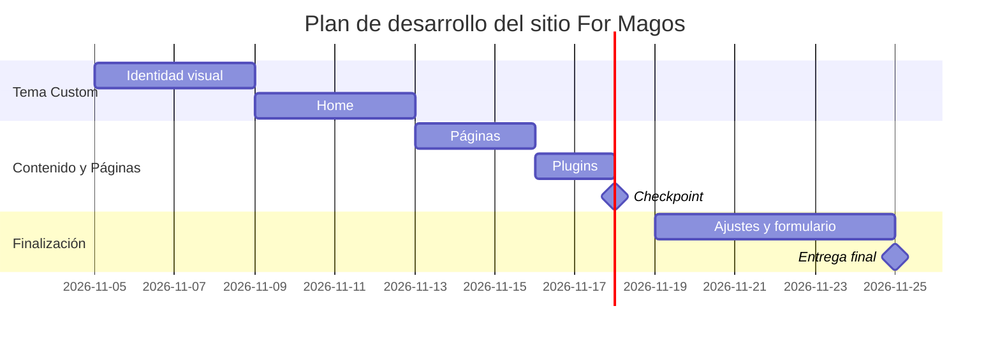

# Decisiones de mi sitio

**Emprendimiento:** For Magos (4.MAGOS)
**Fecha:** 25 de noviembre · **Última corrección:** 04 de noviembre de 2026

## 1. Plugins (10 pts)

Al menos **5 plugins**, cada uno vale 2 pts. **SEO** y **contacto** son obligatorios; los otros 3 los eliges según lo que necesita tu sitio (parte de `docs/03-funcionalidades.md`). Guía: `guia-investigar-plugins.md`.

| # | Funcionalidad | Plugin | Gratis o de pago | Qué incluye la versión gratis | Probado hasta (WP) | Requiere PHP | ¿Funciona con tema propio? | Enlace a la ficha |
|---|---|---|---|---|---|---|---|---|
| 1 | SEO (obligatorio) | Yoast SEO | Gratis (con versión Premium) | Optimización SEO on-page, análisis de legibilidad, sitemaps XML automáticos y previsualización para motores de búsqueda y redes sociales. | 6.7 | 7.4 o superior | Sí | https://wordpress.org/plugins/wordpress-seo/ |
| 2 | Contacto (obligatorio) | Contact Form 7 | Gratis | Formularios de contacto personalizables para consultas sobre camisetas, estampados personalizados, tallas y envíos. | 6.7 | 7.4 o superior | Sí | https://wordpress.org/plugins/contact-form-7/ |
| 3 | E-commerce / Catálogo | WooCommerce | Gratis (con extensiones opcionales) | Gestión completa de catálogo de vestuario deportivo, filtrado de productos por liga/equipo, carrito de compras y pasarela de pago. | 6.7 | 7.4 o superior | Sí | https://wordpress.org/plugins/woocommerce/ |
| 4 | Optimización de Imágenes | Smush – Lazy Load, Optimize & Compress | Gratis (con opción Pro) | Compresión automática de imágenes de camisetas sin pérdida de calidad y carga diferida (lazy load) para mejorar velocidad. | 6.7 | 7.4 o superior | Sí | https://wordpress.org/plugins/wp-smushit/ |
| 5 | Seguridad / Firewall | Wordfence Security | Gratis (con opción Premium) | Firewall de aplicaciones web (WAF), escáner de seguridad y protección en tiempo real contra ataques de fuerza bruta en el inicio de sesión. | 6.7 | 7.4 o superior | Sí | https://wordpress.org/plugins/wordfence/ |

## 2. Páginas de la fase 1 (5 pts)

**5 páginas**, 1 pt cada una. **Inicio** y **Contacto** son obligatorias; las otras 3 las eliges (no pueden ser del carro de compras).

| # | Página | Por qué la elijo (una línea) |
|---|---|---|
| 1 | Inicio (obligatoria) | Vitrina principal con banners promocionales, novedades y lanzamientos de camisetas destacadas. |
| 2 | Contacto (obligatoria) | Canal directo para atender dudas sobre stock, envíos regionales y solicitudes de estampado personalizado. |
| 3 | Catálogo / Tienda | Despliega todos los productos organizados por categorías (Fútbol Chileno, Ligas Europeas, Retro, Vestuario). |
| 4 | Sobre Nosotros | Presenta la propuesta de valor de For Magos, la pasión por el fútbol y el compromiso con la calidad. |
| 5 | Guía de Tallas y Envíos | Proporciona la tabla de medidas exactas de las camisetas e información transparente sobre plazos de entrega. |

**Páginas que dejo para después:**
- Preguntas Frecuentes (FAQ)
- Galería de Fotos de Clientes / Reseñas
- Blog de Historias y Coleccionismo Camisetero

## 3. Plan del tema (5 pts)

- **Nombre del tema:** Formagos Custom Athletic (`formagos-theme`)
- **Custom o descargado:** Custom (creado desde cero para garantizar un diseño deportivo premium oscuro/dorado, ligero y optimizado para móviles).
- **Carta Gantt** del desarrollo del sitio (5 al 25 de noviembre). Puedes usar esta tabla o un diagrama Mermaid.

| Etapa | Desde | Hasta | Notas |
|---|---|---|---|
| Identidad visual | 05 nov | 08 nov | Selección de paleta (negro/dorado), tipografías deportivas y maquetación UI/UX. |
| Home | 09 nov | 12 nov | Estructura del index, carrusel principal, categorías y productos destacados. |
| Páginas | 13 nov | 15 nov | Creación e integración de plantillas para Tienda, Sobre Nosotros, Guía de Tallas y Contacto. |
| Plugins | 16 nov | 17 nov | Instalación y configuración de WooCommerce, Yoast SEO, Contact Form 7, Smush y Wordfence. |
| **Checkpoint (18 nov)** | 18 nov | 18 nov | Revisión de avances, prueba de formularios y aplicación de correcciones. |
| Ajustes y formulario | 19 nov | 24 nov | Corrección de detalles visuales, responsividad móvil y pruebas de navegación. |
| **Entrega final (25 nov)** | 25 nov | 25 nov | Despliegue final, verificación de requisitos y entrega formal del proyecto. |

## 4. Plan B (5 pts)

Qué hago si algo no funciona. **Al menos 3 riesgos**, cada uno con su mitigación y cuándo se activa.

| Riesgo | Qué hago | Cuándo se activa (fecha o señal) |
|---|---|---|
| El tema propio no funciona o se rompe | Cambiar inmediatamente a un tema base optimizado (Storefront o Astra) y personalizar mediante CSS adicional. | Se activa si al 12 de noviembre el tema personalizado presenta errores graves de PHP o CSS insalvables. |
| Un plugin falla o no es compatible | Desactivar el plugin conflictivo y reemplazar por una alternativa equivalente probada (ej. WPForms en lugar de Contact Form 7). | Se activa al detectar incompatibilidades en las pruebas o errores en la consola de JavaScript. |
| WooCommerce o el carrito dinámico presenta fallos | Utilizar el catálogo en modo vitrina e integrar botones de pedido directo a través de WhatsApp. | Se activa si el 16 de noviembre no es posible procesar la selección de productos o el flujo de compra. |

## Cambios respecto de la Sumativa 2 (solo en el checkpoint del 18 nov)

| Qué cambié | Qué había antes | Por qué | Evidencia (captura o commit) |
|---|---|---|---|
| | | | |

**Decisión:** (continúo con mi propuesta / pivoteo, y por qué)
