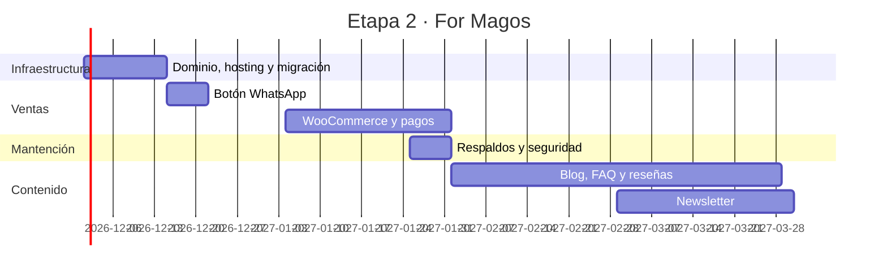

# Plan de continuidad · Etapa 2 de mi sitio

**Emprendimiento:** For Magos (4.MAGOS) · camisetas de fútbol actuales y retro, vestuario deportivo y ropa urbana
**Sitio de la etapa 1:** https://formagos.infinityfreeapp.com
**Fecha:** 25 de noviembre de 2026

## 1. Qué quedó fuera de la etapa 1 y por qué (3 pts)

En la etapa 1 dejé el sitio vitrina: Inicio, Catálogo, Sobre Nosotros, Guía de Tallas y Envíos y Contacto, con SEO y formulario funcionando. Estas funcionalidades quedaron para la etapa 2:

| Funcionalidad | Por qué quedó fuera (tiempo, recursos, costo, conocimientos) | Qué aporta a mi emprendimiento |
|---|---|---|
| Tienda con WooCommerce (carrito, stock por talla, pagos) | **Recursos y costo:** el hosting gratuito de InfinityFree tiene límites de CPU/memoria y da errores 500/429 con plugins pesados; además necesito HTTPS estable y una pasarela de pago (Webpay/Mercado Pago) con cuenta comercial. **Tiempo:** cargar productos con variaciones de talla toma semanas. | Vender en línea 24/7 sin depender de mensajes por Instagram o WhatsApp; controlar el stock por talla. |
| Pedido por WhatsApp desde cada producto | **Tiempo:** en la etapa 1 prioricé que el sitio esté publicado y el formulario funcione. | Puente rápido para vender mientras la tienda no está lista: el cliente consulta con un clic. |
| Blog "Historias y Coleccionismo Camisetero" | **Tiempo:** escribir buenos artículos (historia de camisetas retro, cómo reconocer una original) requiere investigación y fotos propias. | Atraer visitas desde Google (SEO) y generar confianza con coleccionistas. |
| Preguntas frecuentes (FAQ) y reseñas de clientes | **Tiempo y contenido:** necesito juntar preguntas reales y fotos de clientes con su permiso. | Responder dudas antes de comprar (tallas, envíos, originalidad) y mostrar prueba social. |
| Newsletter de lanzamientos | **Conocimientos y costo:** hay que aprender a usar una herramienta de email marketing y cumplir con el consentimiento de los suscriptores. | Avisar de nuevas camisetas y ofertas a clientes que ya compraron. |
| Copias de seguridad automáticas y seguridad avanzada (Wordfence) | **Recursos:** en InfinityFree los respaldos automáticos y el firewall consumen recursos que el plan gratuito limita. | Proteger el sitio cuando tenga ventas y datos de clientes. |

## 2. Recursos que necesito (2 pts)

| Funcionalidad | Plugin o herramienta | Gratis o de pago | Costo aproximado | Qué tendría que aprender |
|---|---|---|---|---|
| Tienda | WooCommerce | Gratis | $0 | Crear productos variables (tallas S–XXL), categorías por liga, envíos y correos de pedido. |
| Pagos en Chile | Plugin oficial de Transbank Webpay Plus o Mercado Pago para WooCommerce | Gratis el plugin; comisión por venta | ~3% por transacción aprox. | Configurar credenciales de prueba y producción; probar compras de prueba. |
| Botón de WhatsApp | Click to Chat (o Joinchat) | Gratis | $0 | Configurar el mensaje predeterminado con el nombre del producto. |
| Newsletter | MailPoet (versión gratis) o Mailchimp | Gratis hasta cierto número de suscriptores | $0 al inicio; luego ~US$10–20/mes | Formularios de suscripción, listas y diseño de correos. |
| Respaldos | BackWPup (guardando en Google Drive o Dropbox) | Gratis | $0 | Programar respaldos semanales y probar una restauración. |
| Seguridad | Wordfence Security | Gratis (Premium opcional) | $0 | Revisar alertas, activar 2FA y limitar intentos de inicio de sesión. |
| Imágenes livianas | Smush | Gratis (Pro opcional) | $0 | Comprimir fotos de camisetas y usar formato WebP. |
| Dominio propio | formagos.cl (NIC Chile) | De pago | ~$10.000 CLP/año | Apuntar los DNS al nuevo hosting. |

**Servidor:** para la etapa 2 necesito un **hosting compartido pagado** (por ejemplo, un plan WordPress básico de un proveedor chileno o internacional, entre $3.000 y $8.000 CLP/mes) con: **PHP 8.1 o superior**, **MySQL/MariaDB**, al menos **10 GB SSD**, **certificado SSL (HTTPS) gratuito** con Let's Encrypt, sin límites diarios de visitas como los de InfinityFree, correo con el dominio (contacto@formagos.cl) y **respaldos automáticos**. WooCommerce y una pasarela de pago exigen HTTPS y un servidor estable.

## 3. Priorización y cronograma (2 pts)

| Prioridad | Qué hago | Cuándo (mes o semana) | Resultado esperado |
|---|---|---|---|
| 1 | Comprar dominio y hosting pagado; migrar el sitio con mi respaldo (ver README) y activar HTTPS | Diciembre 2026 · semanas 1 y 2 | Sitio en formagos.cl con candado y sin errores 500/429. |
| 2 | Botón de WhatsApp en Catálogo y en cada camiseta | Diciembre 2026 · semana 3 | Primeras ventas por consulta directa desde el sitio. |
| 3 | WooCommerce: cargar 20–30 camisetas con tallas, envíos y pago con Webpay/Mercado Pago (primero en modo prueba) | Enero 2027 (4 semanas) | Tienda funcionando y primera compra real. |
| 4 | Respaldos automáticos con BackWPup + Wordfence | Enero 2027 · semana 4 | Copia semanal fuera del servidor y sitio protegido. |
| 5 | Blog (1 artículo cada 2 semanas) y página de FAQ y reseñas | Febrero y marzo 2027 | Más visitas desde Google y más confianza. |
| 6 | Newsletter de lanzamientos | Marzo 2027 | Lista de suscriptores y correo mensual de novedades. |

## 4. Riesgos y mitigación (1 pt)

| Riesgo | Qué haría | Cuándo se activa |
|---|---|---|
| El hosting pagado o la comisión de la pasarela cuesta más de lo previsto | Partir con WhatsApp + transferencia y el plan de hosting más básico; contratar Webpay cuando haya ventas que lo justifiquen. | Si el costo mensual supera ~$10.000 CLP o las ventas no cubren el hosting. |
| La migración rompe el sitio (enlaces, imágenes o menú) | Restaurar el respaldo en el servidor anterior, revisar la URL del sitio y guardar de nuevo los enlaces permanentes; seguir el checklist del README. | Si después de migrar aparecen errores 404, imágenes rotas o pantalla en blanco. |
| WooCommerce pone lento el sitio o no es compatible con el tema | Desactivar plugins que no uso, optimizar imágenes con Smush, activar caché; si falla, usar el catálogo en modo vitrina con botón de WhatsApp (Plan B). | Si Lighthouse móvil baja de 40 en Rendimiento o aparecen errores al comprar. |
| Hackeo o pérdida de datos | Restaurar la última copia de BackWPup, cambiar contraseñas y actualizar todo. | Si el sitio muestra contenido extraño, redirecciones o deja de abrir. |
